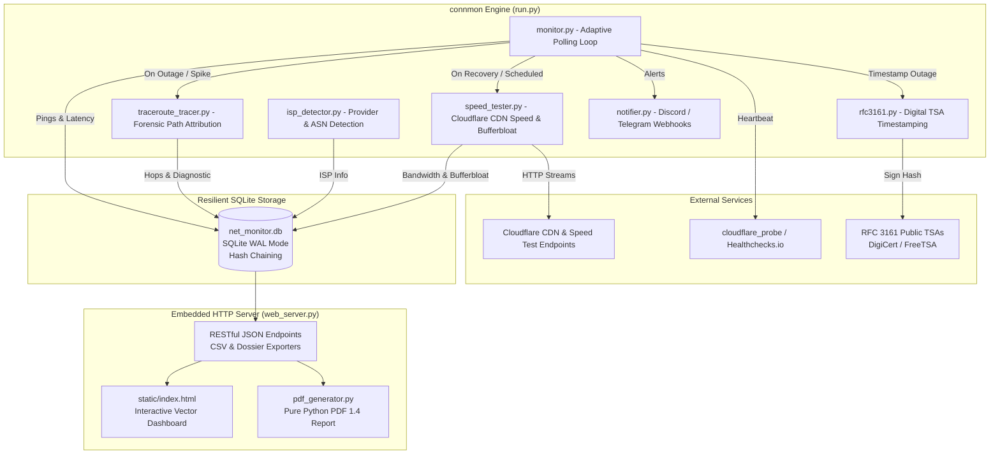

# connmon

<p align="center">
  <strong>Ultra-lightweight (~13MB RAM), zero-dependency network telemetry daemon & ISP outage auditor with embedded web dashboard, RFC 3161 digital timestamps, cryptographic hash chaining, and automated forensic route tracing.</strong>
</p>

<p align="center">
  <a href="README.md">🇺🇸 English</a> | <a href="README.pt-BR.md">🇧🇷 Português</a>
</p>

<p align="center">
  <a href="https://github.com/marcosbinder/connmon/actions/workflows/ci.yml"></a>
  <a href="https://github.com/marcosbinder/connmon/releases"></a>
  
  
  
  
  <a href="LICENSE"></a>
</p>

---

## Overview

**connmon** is an autonomous, production-grade network monitor and legal-admissibility audit toolkit written in pure Python. It was designed from the ground up for homelabs, Raspberry Pis, mini PCs, and Linux/Windows home servers where resource footprints matter.

Consuming only **~13MB of RAM** and requiring **zero external dependencies** (using solely the Python standard library and built-in SQLite in WAL mode), `connmon` continuously benchmarks latency, jitter, packet loss, DNS resolution, Bufferbloat, and bandwidth speeds via Cloudflare's CDN.

When connection drops or severe degradation occur, `connmon` dynamically increases sampling frequency, performs forensic route tracing (Traceroute) to pinpoint the exact failing hop (ISP vs LAN), seals outage logs with **RFC 3161 digital timestamps** and **HMAC SHA-256 hash chaining**, and produces court-admissible dossiers (PDF 1.4 + CSV + SHA-256 manifest) compliant with digital chain of custody standards (ISO/IEC 27037).

---

## Key Highlights

- **Ultra-Lightweight & Zero-Dependency**:
  Runs anywhere Python 3.9+ is installed. No pip dependencies required for production runtime—no heavy web frameworks, no bloated browser headless engines, no third-party database drivers.
- **Forensic ISP Accountability & Non-Repudiation**:
  - **Cryptographic Hash Chaining**: Every ping, outage, speed measurement, and traceroute hop links to its predecessor (`prev_hash` + `record_hash` HMAC-SHA256), preventing retroactive tampering or database falsification.
  - **RFC 3161 Certified Digital Timestamps**: Direct integration with trusted public Time Stamping Authorities (TSA) such as DigiCert and FreeTSA to generate verifiable cryptographic evidence for telecom regulators (Anatel, FCC, Ofcom) or consumer protection agencies (PROCON).
  - **Automated Traceroute & Fault Attribution**: Automatically attributes outages to either your local network (`LAN`), the internet provider (`ISP`), or external routing bottlenecks (`EXTERNAL`).
  - **Dual-Check External Witness**: Optional integration with [Cloudflare Workers](cloudflare_probe/) or [Healthchecks.io](https://healthchecks.io) to independently confirm downtime from the cloud.
- **Real-Time Web Dashboard**:
  Responsive, modern single-page dashboard with zero build steps, rendering vector charts for latency, jitter, packet loss, outage timelines, and speed history.
- **Automated Financial SLA Reimbursement**:
  Calculates exact regulatory billing discounts based on accumulated downtime seconds and your monthly service fee.
- **Bufferbloat & Bandwidth Benchmarks**:
  Measures idle latency vs loaded latency (RFC 3550 / RFC 4689 grade `A+` to `F`) and runs bandwidth benchmarks directly against Cloudflare's global edge network.
- **Real-Time Webhook Alerts**:
  Built-in asynchronous dispatchers for Discord rich embeds and Telegram bot notifications for instant drop detection and recovery notices.

---

## Web Dashboard Preview

<p align="center">
  
</p>

> *Screenshot placeholder: The web dashboard updates automatically every 10 seconds via asynchronous REST APIs.*

---

## Architecture & Module Interaction



### Module Responsibilities:
- `run.py`: CLI entry point, process coordinator, signal handling (`SIGINT`/`SIGTERM`), and thread lifecycle manager.
- `monitor.py`: Dual-target ICMP/TCP ping probe (1.1.1.1, 8.8.8.8), DNS resolution verifier, and adaptive state machine (switches to 2-second resolution during outages).
- `speed_tester.py`: Bandwidth engine using chunked streaming over Cloudflare CDN with concurrent loaded latency probes to grade Bufferbloat.
- `isp_detector.py`: Provider auto-detection caching external IP, ASN organization, and geolocation.
- `rfc3161.py`: Pure stdlib DER-encoded `TimeStampReq` client querying RFC 3161 TSAs and verifying token digests.
- `traceroute_tracer.py`: Multi-platform path tracing parser detecting drop hops and attributing fault (`ISP` vs `LAN`).
- `db.py`: Thread-safe SQLite manager in WAL mode featuring HMAC-SHA256 sequential hash chains on every telemetry table.
- `pdf_generator.py`: Native implementation of the Adobe PDF 1.4 specification in pure Python, generating forensic dispute reports without ReportLab or WeasyPrint.
- `notifier.py`: Async webhook alerts for Discord and Telegram.
- `web_server.py`: High-concurrency `ThreadingHTTPServer` serving REST API endpoints, CSV exports, forensic ZIP dossiers, and static assets.
- `cloudflare_probe/`: Serverless witness Worker running on Cloudflare's free tier.

---

## Quickstart & Installation

### Prerequisites
- Python 3.9 or higher (Linux, macOS, or Windows).
- No external packages required!

### 1. Clone & Run Directly

```bash
# Clone repository
git clone https://github.com/marcosbinder/connmon.git
cd connmon

# Run on default port 8080
python3 run.py
```

Open your browser at **`http://localhost:8080`** (or access via your server's local LAN IP: `http://192.168.x.x:8080`).

---

### Running on Linux / Raspberry Pi / Homelab

#### Option A: Native Systemd Service (Recommended for 24/7 background monitoring)

Create `/etc/systemd/system/connmon.service`:

```ini
[Unit]
Description=connmon Network Telemetry & ISP Auditor Daemon
After=network-online.target
Wants=network-online.target

[Service]
Type=simple
User=root
WorkingDirectory=/opt/connmon
ExecStart=/usr/bin/python3 /opt/connmon/run.py --host 0.0.0.0 --port 8080
Restart=always
RestartSec=5
StandardOutput=journal
StandardError=journal
Environment=PYTHONUNBUFFERED=1

[Install]
WantedBy=multi-user.target
```

Enable and start the daemon:
```bash
sudo systemctl daemon-reload
sudo systemctl enable --now connmon.service
sudo systemctl status connmon.service
```

#### Option B: PM2 Process Manager
```bash
# Using the bundled start script
chmod +x start_linux.sh
./start_linux.sh
```

---

### Running on Windows

- Simply double-click **`start_windows.bat`**, or run in PowerShell / Command Prompt:
```cmd
python run.py --port 8080
```

---

## CLI Reference

`run.py` provides a complete command-line interface for automation, cron jobs, and terminal debugging:

| Flag | Argument | Default | Description |
|---|---|---|---|
| `--port` | `<int>` | `8080` (or `$NETMON_PORT` / `$PORT`) | Port for the embedded Web Dashboard |
| `--host` | `<str>` | `0.0.0.0` | Bind host address (`0.0.0.0` allows LAN access) |
| `--ping-interval` | `<seconds>` | `30` | Interval between ping health checks in stable state |
| `--speed-interval`| `<minutes>` | `5` | Interval between scheduled complete speed tests |
| `--monitor-only` | *flag* | `false` | Run background network monitor only (no web server) |
| `--web-only` | *flag* | `false` | Run web dashboard server only (no ping probe) |
| `--report` | *flag* | `false` | Print formatted technical ISP outage report to stdout |
| `--hours` | `<int>` | `72` | Hours lookback window used when generating `--report` |
| `--test-speed` | *flag* | `false` | Run immediate speed test and print results to terminal |
| `--export` | `<table_name>` | *none* | Export table (`pings`, `speed_tests`, `outages`) to CSV |

### Examples:

```bash
# Run speed test immediately
python run.py --test-speed

# Generate technical report for the last 7 days (168 hours)
python run.py --report --hours 168

# Export outages database to CSV file
python run.py --export outages > outages_audit.csv

# Run headless daemon on custom port
python run.py --port 9090 --ping-interval 15
```

---

## REST API Reference

The embedded HTTP server exposes a complete REST API:

- `GET /api/status`: Current connectivity state, active outage, recent speed test, and 24h summary.
- `GET /api/isp`: Detected provider, ASN, public IP, and geolocation (`?refresh=1` forces re-check).
- `GET /api/metrics?hours=24`: Time-series telemetry points for charting (latency, jitter, loss, speeds).
- `GET /api/outages?limit=150`: Historical outage log with duration, severity, and cryptographic hash.
- `GET /api/report?hours=72&download=1`: Textual audit report formatted for technical ISP support tickets.
- `GET /api/report_json?hours=72`: Comprehensive structured forensic metrics and financial refund data.
- `GET /api/integrity`: Cryptographic hash chain verification across all database records.
- `GET /api/export?table=pings`: CSV download of database tables.
- `GET /api/export_dossier?hours=72`: Download complete legal dispute dossier ZIP (PDF + CSVs + SHA-256 signatures).
- `GET /api/traces`: Forensic route trace diagnostics and hop breakdown.
- `POST /api/trigger_speedtest`: Trigger asynchronous background speed test.
- `POST /api/trigger_traceroute`: Trigger asynchronous forensic route trace.
- `POST /api/test_notification`: Send test alerts to configured Discord/Telegram webhooks.
- `POST /api/config`: Update contracted speed thresholds, webhook URLs, and billing values.
- `POST /api/cleanup`: Prune old telemetry data (`{"days": 30}`).
- `POST /api/reset`: Reset database with audit logging.

---

## Testing & Quality Assurance

`connmon` features a comprehensive suite of **153 automated tests** organized across architectural tiers:

- **Tier 1 (Core Capabilities)**: Verifies the ICMP/TCP ping probe, HMAC hash chaining, telemetry persistence, and ISP detection.
- **Tier 2 (Boundaries & Edge Cases)**: Evaluates extreme network timeouts, connection drop recovery, corrupted telemetry isolation, and database locking.
- **Tier 3 (Integration & Pairwise Concurrency)**: Tests atomic outage closures under heavy concurrent write loads and dynamic report recalculations.
- **Tier 4 (Stress & Workloads)**: Benchmarks memory stability, high-frequency polling bursts, and SQLite index performance.
- **Phase 3 (Forensic Integrity)**: Validates RFC 3161 DER structures, Bufferbloat grading math, pure Python PDF 1.4 byte generation, and route tracer parsing.

To run the full suite locally:

```bash
# Install development tooling
python -m pip install -e ".[dev]"

# Run Ruff linter
ruff check .

# Run complete pytest test suite (153 tests)
python -m pytest -v
```

---

## License

This project is licensed under the **MIT License** — see the [LICENSE](LICENSE) file for details.

Copyright (c) 2026 **Marcos Binder**.
