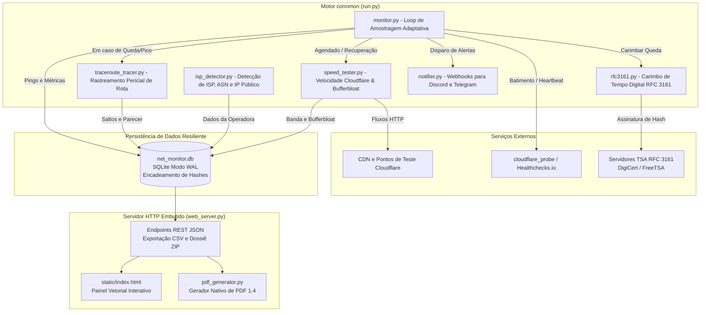

# connmon

<p align="center">
  <strong>Monitor de telemetria de rede e auditoria forense de quedas em Python, ultra-leve (~13MB de RAM) e zero-dependency. Inclui dashboard web embutido, carimbo de tempo digital RFC 3161, encadeamento criptográfico de hashes e rastreamento pericial de rotas.</strong>
</p>

<p align="center">
  <a href="README.md">🇺🇸 English</a> | <a href="README.pt-BR.md">🇧🇷 Português</a>
</p>

<p align="center">
  <a href="https://github.com/marcosbinder/connmon/actions/workflows/ci.yml"></a>
  <a href="https://github.com/marcosbinder/connmon/releases"></a>
  
  
  
  
  <a href="LICENSE"></a>
</p>

---

## Visão Geral

O **connmon** é um daemon de monitoramento contínuo de rede e ferramenta de auditoria de nível pericial desenvolvido em Python puro. Foi concebido especificamente para rodar em servidores caseiros (homelabs), Raspberry Pis, mini PCs e estações Linux/Windows com consumo mínimo de recursos de hardware.

Consumindo apenas **~13MB de memória RAM** e operando com **zero dependências externas obrigatórias** (utiliza exclusivamente a biblioteca padrão do Python e SQLite nativo em modo WAL), o `connmon` mede continuamente latência, jitter, perda de pacotes, resolução de DNS, Bufferbloat e velocidades de download/upload através da rede Anycast da Cloudflare.

Ao detectar quedas ou instabilidade acentuada, o `connmon` ativa uma amostragem adaptativa de alta resolução (a cada 2 segundos), executa diagnósticos automatizados de rota (Traceroute) para identificar o nó exato da falha (se o problema é da operadora ou do roteador local), assina os registros com **Carimbo de Tempo Digital RFC 3161** e **encadeamento de hashes HMAC SHA-256**, e gera dossiês periciais completos (Laudo em PDF 1.4 + CSVs brutos + assinaturas SHA-256) prontos para instrução em processos no JEC, PROCON ou ANATEL (em conformidade com a norma ISO/IEC 27037 de cadeia de custódia).

---

## Diferenciais e Destaques

- **Ultra-Leve e Sem Dependências Externas (Zero-Dependency)**:
  Roda em qualquer máquina com Python 3.9 ou superior. Sem `pip install` obrigatório para execução — dispensando frameworks pesados como Flask/Django, browsers headless ou drivers adicionais de banco de dados.
- **Auditoria Forense e Prova Jurídica (Responsabilidade da Operadora)**:
  - **Encadeamento Criptográfico de Hashes (Blockchain-Style)**: Cada medição de ping, queda, teste de velocidade e salto de rota é vinculada matematicamente à anterior (`prev_hash` + `record_hash` HMAC-SHA256), impedindo qualquer alteração ou falsificação retroativa no banco de dados.
  - **Carimbo de Tempo Digital Certificado (RFC 3161)**: Comunicação direta com Autoridades Certificadoras públicas (TSA), como DigiCert e FreeTSA, gerando tokens criptográficos com valor probatório incontestável.
  - **Traceroute Pericial com Atribuição de Falhas**: Analisa os saltos de rede em tempo real no momento da queda e emite um parecer técnico que atribui formalmente se a indisponibilidade foi na rede interna do cliente (`LAN`), na infraestrutura da operadora (`ISP`) ou na rota externa internacional (`EXTERNAL`).
  - **Testemunha Externa Neutra**: Suporte opcional à sonda em nuvem via [Cloudflare Workers](cloudflare_probe/) ou [Healthchecks.io](https://healthchecks.io), registrando o downtime a partir da internet para anular alegações de que o cliente simplesmente desligou o monitor.
- **Dashboard Web em Tempo Real**:
  Interface moderna, responsiva e com gráficos vetoriais leves para visualização de latência, jitter, histórico de incidentes e velocidade.
- **Cálculo Automático de Desconto na Fatura (Resolução ANATEL)**:
  Calcula automaticamente o valor financeiro exato a ser abatido na mensalidade da internet proporcionalmente aos segundos de interrupção acumulados.
- **Avaliação de Bufferbloat (RFC 3550 / RFC 4689)**:
  Mede o impacto da latência sob carga ativa de transferência, classificando a conexão de `A+` a `F`.
- **Notificações Instantâneas via Webhooks**:
  Envio automático e assíncrono de alertas com Embeds para Discord e mensagens para bots do Telegram.

---

## Demonstração do Painel Web

<p align="center">
  
</p>

> *Espaço para captura de tela: O painel web atualiza dinamicamente via chamadas assíncronas de API REST a cada 10 segundos.*

---

## Arquitetura e Interação de Módulos



### Papel de Cada Módulo:
- `run.py`: Ponto de entrada, orquestrador de threads, captura graciosa de sinais (`SIGINT`/`SIGTERM`) e CLI de comandos.
- `monitor.py`: Motor de sondagem de ping redundante (1.1.1.1 e 8.8.8.8) com amostragem adaptativa (passa para intervalos de 2s durante incidentes para cravar a duração precisa em segundos).
- `speed_tester.py`: Medidor de largura de banda via CDN da Cloudflare com avaliação concorrente de Bufferbloat (latência sob carga).
- `isp_detector.py`: Identificação de provedor, ASN, IP público e geolocalização com cache em memória de 6 horas.
- `rfc3161.py`: Cliente de Carimbo do Tempo Digital em Python puro com montagem de estruturas DER compatíveis com RFC 3161.
- `traceroute_tracer.py`: Analisador de rotas multiplataforma que audita os saltos de IP e emite diagnóstico conclusivo de responsabilidade.
- `db.py`: Camada de banco de dados SQLite com journal WAL, timeout de concorrência de 30s e assinaturas HMAC-SHA256 em cadeia.
- `pdf_generator.py`: Motor independente de geração de PDF 1.4 em coordenadas A4 para criação de laudos periciais sem bibliotecas de terceiros.
- `notifier.py`: Despacho assíncrono em segundo plano de notificações para Discord e Telegram.
- `web_server.py`: Servidor HTTP multithreaded que provê a API REST JSON, downloads de CSVs, geração de dossiês ZIP e o painel HTML.
- `cloudflare_probe/`: Código para Worker serverless na Cloudflare para testemunha externa.

---

## Guia de Instalação e Uso Rápido

### Requisitos
- Python 3.9 ou superior (Linux, Windows ou macOS).
- Nenhuma dependência externa obrigatória.

### 1. Clonar e Rodar Imediatamente

```bash
# Clone o repositório
git clone https://github.com/marcosbinder/connmon.git
cd connmon

# Inicie o monitor e o dashboard na porta 8080
python3 run.py
```

Abra o navegador no endereço: **`http://localhost:8080`** (ou use o IP local do servidor na rede: `http://192.168.x.x:8080`).

---

### Executando no Linux / Raspberry Pi / Servidor Doméstico

#### Opção A: Como Serviço do Sistema com Systemd (Recomendado para 24/7)

Crie o arquivo `/etc/systemd/system/connmon.service`:

```ini
[Unit]
Description=connmon - Monitor de Conexao e Auditor de Rede
After=network-online.target
Wants=network-online.target

[Service]
Type=simple
User=root
WorkingDirectory=/opt/connmon
ExecStart=/usr/bin/python3 /opt/connmon/run.py --host 0.0.0.0 --port 8080
Restart=always
RestartSec=5
StandardOutput=journal
StandardError=journal
Environment=PYTHONUNBUFFERED=1

[Install]
WantedBy=multi-user.target
```

Ative e inicie o serviço:
```bash
sudo systemctl daemon-reload
sudo systemctl enable --now connmon.service
sudo systemctl status connmon.service
```

#### Opção B: Via Gerenciador de Processos PM2
```bash
chmod +x start_linux.sh
./start_linux.sh
```

---

### Executando no Windows

- Dê um duplo-clique no arquivo **`start_windows.bat`**, ou execute no PowerShell/CMD:
```cmd
python run.py --port 8080
```

---

## Referência Completa de Linha de Comando (CLI)

O arquivo `run.py` disponibiliza parâmetros de linha de comando para automação, scripts de terminal e testes:

| Parâmetro | Tipo | Padrão | Descrição |
|---|---|---|---|
| `--port` | `<int>` | `8080` (ou `$NETMON_PORT` / `$PORT`) | Porta HTTP do Dashboard Web |
| `--host` | `<str>` | `0.0.0.0` | IP de escuta (`0.0.0.0` permite acesso remoto na LAN) |
| `--ping-interval` | `<segundos>` | `30` | Intervalo entre checagens de ping em estado normal |
| `--speed-interval`| `<minutos>` | `5` | Intervalo entre testes completos de velocidade |
| `--monitor-only` | *booleano* | `false` | Executa apenas o monitor em segundo plano (sem servidor web) |
| `--web-only` | *booleano* | `false` | Executa apenas o servidor web do painel (sem ping) |
| `--report` | *booleano* | `false` | Imprime no terminal o laudo técnico formatado para a operadora |
| `--hours` | `<int>` | `72` | Janela de horas analisada com `--report` |
| `--test-speed` | *booleano* | `false` | Executa um teste imediato de velocidade e exibe o resultado |
| `--export` | `<tabela>` | *nenhum* | Exporta a tabela informada (`pings`, `speed_tests`, `outages`) em CSV |

### Exemplos Práticos:

```bash
# Executa um teste de velocidade avulso
python run.py --test-speed

# Emite o relatório técnico dos últimos 7 dias (168 horas)
python run.py --report --hours 168

# Exporta o histórico de quedas para arquivo CSV
python run.py --export outages > historico_quedas.csv

# Roda apenas o monitor em background com checagem a cada 15 segundos
python run.py --monitor-only --ping-interval 15
```

---

## Endpoints da API REST

O servidor web HTTP integrado fornece endpoints JSON padronizados:

- `GET /api/status`: Estado atual da conectividade, última queda, resumo de velocidade e KPIs das últimas 24 horas.
- `GET /api/isp`: Informações da operadora detectada, ASN, IP público e localidade (`?refresh=1` força reconsulta).
- `GET /api/metrics?hours=24`: Série temporal de pings, latências, jitter e velocidades para gráficos.
- `GET /api/outages?limit=150`: Histórico de interrupções com causa, duração e hash de integridade.
- `GET /api/report?hours=72&download=1`: Laudo técnico textual pronto para abertura de chamados na Anatel ou operadora.
- `GET /api/report_json?hours=72`: Dados periciais estruturados com valores de ressarcimento em R$.
- `GET /api/integrity`: Auditoria da cadeia criptográfica de hashes em todas as tabelas do banco.
- `GET /api/export?table=pings`: Download direto de tabelas em formato CSV.
- `GET /api/export_dossier?hours=72`: Compila e baixa um pacote pericial `.zip` completo (Laudo em PDF + CSVs + Assinaturas SHA-256).
- `GET /api/traces`: Histórico de diagnósticos periciais de rotas e pareceres de responsabilidade.
- `POST /api/trigger_speedtest`: Dispara um teste assíncrono de velocidade em segundo plano.
- `POST /api/trigger_traceroute`: Dispara um rastreamento pericial de rotas em segundo plano.
- `POST /api/test_notification`: Testa os canais configurados de notificação (Discord/Telegram).
- `POST /api/config`: Atualiza parâmetros do plano contratado, metas e webhooks com log de auditoria.
- `POST /api/cleanup`: Realiza expurgo seguro de registros mais antigos que X dias (`{"days": 30}`).
- `POST /api/reset`: Redefine o banco de dados com registro formal no log administrativo.

---

## Testes e Garantia de Qualidade

O `connmon` conta com uma suíte abrangente de **153 testes automatizados** divididos em camadas (Tiers) que cobrem desde regras básicas até estresse de concorrência e conformidade criptográfica:

- **Tier 1 (Funcionalidades Principais)**: Testes unitários do motor de ping, encadeamento de hashes HMAC, persistência de métricas e detecção de operadora.
- **Tier 2 (Limites e Resiliência)**: Validação de timeouts extremos de rede, recuperação após quedas, integridade em bancos SQLite concorrentes e tratamento de exceções.
- **Tier 3 (Integração e Concorrência)**: Fechamento atômico de quedas sob inserções massivas simultâneas e recálculo dinâmico de laudos.
- **Tier 4 (Cargas e Estresse)**: Resistência a volumes intensivos de telemetria e integridade dos índices de banco de dados.
- **Phase 3 (Perícia Avançada)**: Estruturas DER de carimbo RFC 3161, classificação internacional de Bufferbloat, geração pura de PDF 1.4 e parser de rotas.

Para executar a suíte de testes localmente:
```bash
# Instala ferramentas de desenvolvimento
python -m pip install -e ".[dev]"

# Executa o linter Ruff
ruff check .

# Executa todos os 153 testes
python -m pytest -v
```

---

## Licença

Este projeto é distribuído sob os termos da licença **MIT** — consulte o arquivo [LICENSE](LICENSE) para mais detalhes.

Copyright (c) 2026 **Marcos Binder**.
